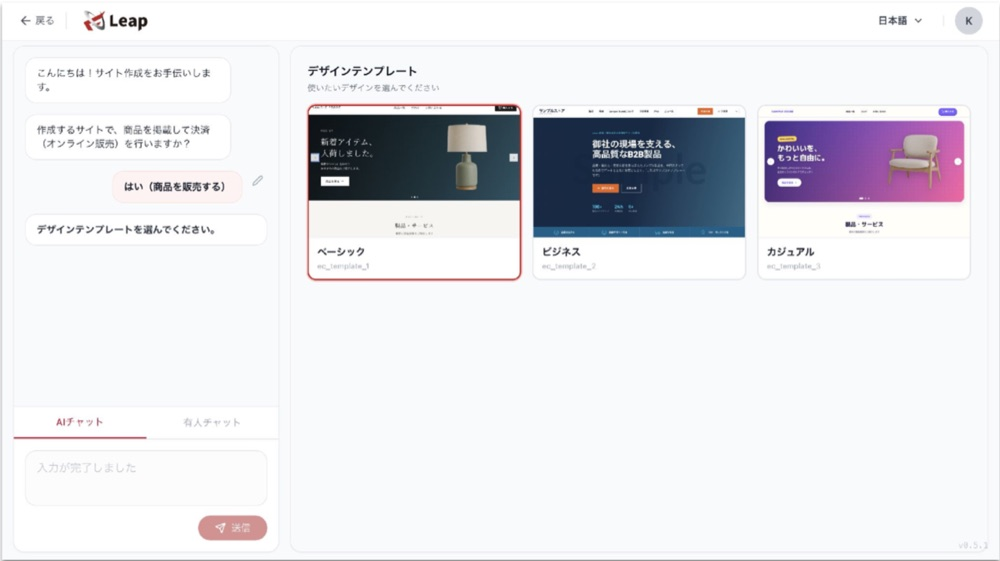

## Quick Overview: How to Start Cross-Border Ecommerce

You launch a cross-border ecommerce business in 8 steps: choose your country and product, check regulations and duties, pick a sales channel, set your prices, prepare your store and payments, decide on shipping and export procedures, set up customer support, and start marketing with a test sale. Following this order helps you avoid costly rework after launch, such as finding out the product can't be sold in that country, or that shipping costs wipe out your margin.

This article walks small and mid-sized businesses through each launch step and what to prepare along the way. It also covers export procedures for shipping by post from Japan, a worked example of how shipping costs affect pricing, and a pre-launch checklist.

## Cross-Border Ecommerce in 8 Steps

Cross-border ecommerce means selling products online to consumers in other countries. Here are the 8 steps to launch:

1. Choose your target country and product
2. Check export and import regulations and duties
3. Choose a sales channel
4. Set prices and a budget that include shipping, duties, and fees
5. Prepare your online store, product pages, and payments
6. Decide on shipping methods and export procedures
7. Set up customer inquiries and returns
8. Start marketing, run a test sale, and improve

Steps 1 through 4 are the planning phase, where you decide what to sell, where, and at what price. Steps 5 through 8 are the execution phase, where you get ready to sell and keep improving as you go. Finishing the planning phase before you build a store is the fastest way to launch.

## Step 1: Choose Your Target Country and Product

The first step is to narrow things down to one country and the first products you will sell there. Best-selling products, popular payment methods, and leading marketplaces and social networks all vary by country, so you can't make the later decisions until you know which customers in which country you are selling which product to.

Compare candidate countries on these points:

- Are products like yours already sold there? (Check local marketplaces and search results.)
- What do similar products sell for locally?
- How long does delivery from Japan take, and how much does it cost?
- Can you provide product pages and customer support in the local language?

Starting with one country and a small number of products is the standard approach. Launching in several countries at once multiplies the regulatory checks, translation, and shipping setup by the number of countries.

## Step 2: Check Export and Import Regulations and Duties

Once you have a candidate country and product, check whether you can ship the product from Japan, whether you can sell it in the destination country, and how much duty applies. Food, cosmetics, health foods, and electrical products in particular are subject to country-specific rules on ingredients, labeling, and safety standards, and may not be sellable as they are.

Check these three things:

1. **Can it be shipped from Japan?** Some items, such as aerosol cans, perfume, nail polish, and power banks, can't be sent by international mail to any country. Each destination also has its own prohibited items, so check Japan Post's list of items that cannot be sent internationally and its country-by-country search.
2. **Does it fall under the destination's import restrictions?** JETRO (the Japan External Trade Organization) summarizes the basic import and export systems of about 60 major countries and regions.
3. **What is the tariff rate?** You can look up tariff rates by product using JETRO's WorldTariff database.

### Register Your Trademark in Every Country Where You Sell

A trademark registered in Japan is not protected abroad, so you need to file in each country where you sell. The Japan Patent Office (JPO) explains that intellectual property rights are independent in each country, and that without a trademark in your target market, another company could register it first and stop you from using your own brand. Under the JPO's subsidy for foreign applications (fiscal 2026), small and mid-sized companies can have half of their foreign filing costs covered, up to 600,000 yen per trademark case (as of November 2026).

## Step 3: Choose a Cross-Border Sales Channel

There are three main ways to sell across borders: list on an overseas marketplace, connect an overseas sales service to your existing Japanese online store, or build your own cross-border online store. You can also outsource listing, translation, and advertising to an operations agency, which works with any of the three.

| Sales channel | Ease of starting | Customer acquisition | Cost structure | Best for |
|---|---|---|---|---|
| Overseas marketplace | Quick to start | Uses the marketplace's traffic | Listing fees and sales commissions | Testing demand first |
| Overseas sales service connected to your existing store | Start with your current store as is | Relies on your existing store's traffic | Varies by service (e.g., fees on overseas sales) | Small trials without changing your site |
| Your own cross-border store | Takes time to prepare | You attract customers yourself | Platform subscription, payment fees, marketing costs | Keeping your brand and customer data in-house |

Leading marketplaces differ by country and region, and include Amazon, Shopee, and Lazada. Marketplaces bring traffic, but they charge sales commissions and make it easy for shoppers to compare prices. Your own store avoids marketplace commissions and lets you own the design and customer data, but you have to attract every customer yourself. Many businesses take a phased approach, testing demand on a marketplace before expanding to their own store.

## Step 4: Set Prices and a Budget That Include Shipping, Duties, and Fees

Cross-border prices should cover the product cost plus international shipping, duties, marketplace and payment fees, and currency fluctuations. Selling at your domestic price can leave nothing after shipping and fees, so before launch, work out how much you keep per sale and how many sales a month you need to cover your advertising.

Duties are set by the destination country's rules. Decide whether the buyer or the seller pays them and state it clearly on your product pages. This prevents problems such as buyers refusing delivery because of an unexpected charge.

### Worked Example: How Much of the Price Goes to Shipping

You can estimate shipping's impact using Japan Post's EMS (Express Mail Service) rates. For Zone 1 (China, South Korea, and Taiwan), EMS costs 1,450 yen up to 500 g and 2,200 yen up to 1 kg (as of November 2026).

| Product price | Packed weight | EMS shipping (Zone 1) | Shipping as % of product price |
|---|---|---|---|
| 3,000 yen | Up to 1 kg | 2,200 yen | About 73% |
| 10,000 yen | Up to 1 kg | 2,200 yen | 22% |

For the same 1 kg parcel, shipping is more than 70% of the price of a 3,000-yen product, but only about 20% of a 10,000-yen product. For low-priced items, build shipping into your pricing strategy, for example by offering bundles or discounting shipping above a certain order value.

## Step 5: Prepare Your Online Store, Product Pages, and Payments

Once you have chosen a sales channel, set up your store, product pages, and payments so that shoppers in your target country can buy without hesitation. Here's what to prepare:

- **Product page translation:** Machine translation alone can leave awkward phrasing, so have someone fluent in the local language review it.
- **Currency display:** Show prices in a currency your target customers understand.
- **Payment methods:** Start with credit cards, and consider adding payment methods popular in your target country, such as Alipay in China.
- **Terms and policies:** State shipping fees, delivery times, return conditions, and who pays duties in the local language.
- **Product photos:** Use photos that show texture and size clearly.

Aim for localization (adapting your wording to local culture and customs) rather than literal translation. A sales pitch that works in Japan won't necessarily work overseas.

## Step 6: Decide on Shipping Methods and Export Procedures

There are three common ways to ship cross-border orders: send each order directly by international mail or courier, store inventory at a fulfillment service's warehouse in Japan and let it handle shipping, or keep inventory in a warehouse in the destination country. In the early days, when orders are few, most businesses start with direct shipping, which has no upfront cost, and consider a fulfillment service once order volume grows.

### Export Procedures When Shipping by Post from Japan

When you ship goods abroad by post from Japan, the export procedure depends on whether the item's value is 200,000 yen or less, or more than 200,000 yen. According to Japan Customs:

1. **200,000 yen or less:** No export declaration to Customs is required. Create a customs declaration form using Japan Post's International Mail My Page service, attach it to the parcel, and send it.
2. **More than 200,000 yen:** An export declaration to Customs is required. Prepare documents such as an invoice, and either ask a customs broker or similar to file it or file it yourself.

### Keep the Documents Needed for the Consumption Tax Export Exemption

Sales made as exports are exempt from Japanese consumption tax. According to the National Tax Agency, you must keep supporting documents for 7 years to claim the export exemption, and the required documents for postal shipments depend on value. For items over 200,000 yen, you need the export permit. For parcel post or EMS items of 200,000 yen or less, you need the proof of acceptance issued by Japan Post along with a copy of the shipping label or similar.

## Step 7: Set Up Customer Inquiries and Returns

Before you start selling, make sure you can answer customer inquiries in your target country's language. Cross-border ecommerce brings more kinds of inquiries than domestic sales, such as delivery delays, duty charges, and damaged items.

Decide these three things in advance:

1. Your contact channels (email or chat) and your target response time
2. An FAQ page covering common questions (shipping fees, delivery times, duties, returns)
3. Who pays which costs in cases of damage, loss, or returns

## Step 8: Start Marketing, Run a Test Sale, and Improve

Simply publishing a cross-border store rarely brings orders, so start marketing at launch and improve based on the results of a test sale. On a marketplace, you still need in-marketplace ads and reviews. With your own store, you attract buyers through local-language SEO (search engine optimization), social media, ads, and email newsletters.

During the test sale, track numbers like these:

- Which countries visitors come from, and which pages they land on
- What percentage of product page visitors make a purchase
- Where shoppers drop off (for example, at the shipping cost display or the payment page)
- What customers ask about most often

Once you see which countries and products respond well, move on to the next decision: adding products, increasing ad spend, or expanding to another country.

## Pre-Launch Checklist for Cross-Border Ecommerce

Here is what to prepare before you start selling cross-border:

- Your target country and first products are decided
- You have confirmed the product can be shipped from Japan and sold in the destination country
- You have looked up tariff rates and decided who pays duties
- You have considered filing a trademark in the destination country
- You have chosen a sales channel (marketplace, overseas sales service, or your own store)
- You have calculated prices and a monthly budget that include shipping and fees
- Product page translation and a native-speaker review are arranged
- Payment methods and display currencies are decided
- Your shipping method, and how you will file export declarations for items over 200,000 yen, are decided
- You know how you will keep documents for the export tax exemption
- Contact channels, an FAQ page, and return conditions are ready
- Your marketing approach and the numbers to track in the test sale are decided

## Launching a Cross-Border Store Through Chat with Leap

With Leap, a cross-border ecommerce tool that lets AI handle marketing too, you can handle Steps 5 and 8 mainly through chat.

1. Answer the chat's questions and pick a template to build your site
2. Set the countries where each product is sold and its base currency
3. Apply the AI's localization suggestions
4. Check visits by country to run test marketing

## FAQ

**Q. Can individuals or small businesses start cross-border ecommerce?**

A. Yes, individuals and small businesses can start cross-border ecommerce. Listing on an overseas marketplace or connecting an overseas sales service to your existing store lets you start without a large upfront investment. A realistic approach is to start with one country and a few products, then expand based on results.

**Q. How much does it cost to start cross-border ecommerce?**

A. There is no single figure, because costs vary widely by sales channel. Splitting costs into upfront costs, monthly fixed costs, per-sale fees, and shipping and advertising makes channels easier to compare. Including advertising in your budget from the start helps keep your plan on track.

**Q. Should I start with a marketplace or my own store?**

A. A marketplace suits you if you want to test demand quickly, while your own store suits you if you want to keep your brand and customer data in-house. Marketplaces bring traffic but charge sales commissions, while your own store keeps fees down but requires you to attract customers yourself. You can also confirm your best sellers on a marketplace before expanding to your own store.

**Q. What should I watch out for when starting cross-border ecommerce?**

A. The biggest things to watch are the destination country's regulations and pricing that includes shipping and duties. Listing without checking regulations can get your sales stopped, and pricing without shipping and fees can put you in the red. If you ship by post from Japan, also note that items over 200,000 yen require an export declaration to Customs.

## Summary and Key Takeaway

You start cross-border ecommerce in 8 steps: choose your country and product, check regulations and duties, pick a sales channel, set your prices, prepare your store and payments, arrange shipping and export procedures, set up customer support, and improve through marketing and a test sale.

Looking back over the 8 steps, building the store is only one of them, Step 5. The planning phase in Steps 1 through 4, deciding what to sell, where, and at what price, is what largely determines success. As the shipping example shows, how much profit you keep from the same product depends heavily on how you design the price and the offer. Finishing the planning phase carefully with one country and a few products, then expanding while watching your test-sale numbers, is the most practical way to launch cross-border ecommerce without overstretching.

Leap is a cross-border ecommerce tool that lets AI handle marketing too. Just chat with it to build a multilingual, multi-currency online store and run overseas marketing such as SEO and email newsletters.

## References

- [6201 Procedures for Sending Postal Items Abroad (Customs Answer) - Japan Customs](https://www.customs.go.jp/tetsuzuki/c-answer/kokusaiyubin/6201_jr.htm)
- [No.6551 Export Exemption from Consumption Tax - National Tax Agency](https://www.nta.go.jp/taxes/shiraberu/taxanswer/shohi/6551.htm)
- [EMS Rate Table - Japan Post](https://www.post.japanpost.jp/send/oversea/charge/list-ems/all.html)
- [Items That Cannot Be Sent by International Mail - Japan Post](https://www.post.japanpost.jp/service/send/oversea/attention/restriction/)
- [Basic Import and Export Systems by Country - JETRO](https://www.jetro.go.jp/world/trade.html)
- [World Tariff Rates (WorldTariff) - JETRO](https://www.jetro.go.jp/theme/export/tariff/)
- [Subsidy Covering Half of Foreign Application Costs - Japan Patent Office](https://www.jpo.go.jp/support/chusho/shien_gaikokusyutugan.html)
