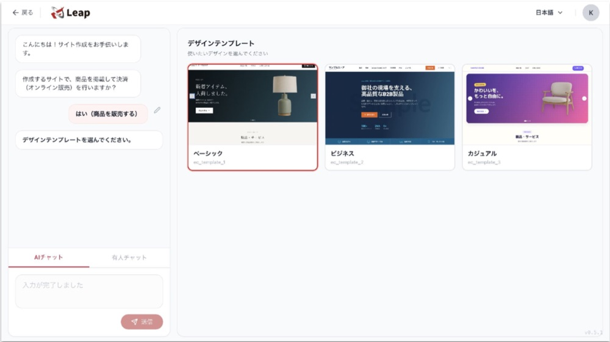

## 【1分で解説！】越境ECの始め方

越境ECは、「販売国と商品を決める → 規制と関税を確かめる → 出店方法を選ぶ → 価格を決める → サイトと決済を整える → 配送と輸出手続きを決める → 問い合わせ体制を整える → 集客とテスト販売を始める」の8つの手順で立ち上げます。順番を守ると、出店した後に「その国では売れない商品だった」「送料を入れたら赤字だった」といった手戻りを防げます。

本記事では、越境ECを始めたい中小企業の担当者向けに、立ち上げの流れと、それぞれの手順で準備することを順番に解説します。郵便で海外に発送するときの輸出手続きや、送料が価格に与える影響の試算、準備することのチェックリストもまとめました。

## 越境ECの始め方は8つの手順で進める

越境ECとは、インターネット通販で国境を越えて海外の消費者に商品を販売することです。越境ECの立ち上げは、次の8つの手順で進めます。

1. 販売する国と商品を決める
2. 輸出・輸入の規制と関税を確かめる
3. 出店方法を選ぶ
4. 送料・関税・手数料を含めて価格と収支を決める
5. 越境ECサイト・商品ページ・決済を準備する
6. 配送方法と輸出手続きを決める
7. 問い合わせ・返品対応の体制を整える
8. 集客とテスト販売で反応を確かめ、改善する

手順1〜4は「何を、どこに、いくらで売るか」を決める計画の段階で、手順5〜8は「売れる状態をつくり、売りながら直す」実行の段階です。サイトを作る前に計画の段階を終えておくことが、越境ECの立ち上げを早く進めるコツです。

## 手順1：販売する国と商品を決める

越境ECの最初の手順は、販売する国と、最初に売る商品を1つの組み合わせに絞ることです。国によって売れる商品、使われる決済手段、主流のECモールやSNSが異なるため、「どの国の、どんな人に、どの商品を売るか」が決まらないと、後の手順を決められません。

販売国を選ぶときは、次の観点で候補を比べます。

- 自社の商品と同じジャンルの商品が、その国で売られているか（現地のモールや検索結果で確かめる）
- 同じような商品の現地での販売価格はいくらか
- 日本からの配送日数と送料はどれくらいか
- 現地の言語で商品ページと問い合わせ対応を用意できるか

最初は1か国・少数の商品から始めるのが基本です。複数の国に同時に出すと、規制の確認、翻訳、配送の準備がすべて国の数だけ増えます。

## 手順2：輸出・輸入の規制と関税を確かめる

販売国と商品の候補が決まったら、その商品を日本から送れるか、販売国で売れるか、関税がいくらかかるかを確かめます。食品・化粧品・健康食品・電気製品などは、国ごとに成分や表示、安全基準のルールが異なり、そのままでは販売できない場合があります。

確かめる項目は次の3つです。

1. **日本から送れるか**：国際郵便では、スプレー缶、香水、マニキュア、モバイルバッテリーなど、どの国にも送れない品物が決まっています。販売国ごとに受け付けない品物もあるため、日本郵便の「国際郵便として送れないもの」と国別の禁制品の検索で確かめます。
2. **販売国の輸入規制に当てはまらないか**：ジェトロ（日本貿易振興機構）は、主要な約60の国・地域について基本的な輸出入制度をまとめています。
3. **関税率はいくらか**：ジェトロの「世界各国の関税率（WorldTariff）」で、商品ごとの関税率を調べられます。

### 商標は販売する国でも出願する

商標は、日本で登録していても外国では権利として成立しないため、販売する国でも出願が必要です。特許庁は、知的財産権が国ごとに独立していること、進出先で商標を取らないと他社に先取りされて自社ブランドを使えなくなるリスクがあることを説明しています。特許庁の外国出願補助金（令和8年度）では、中小企業の外国出願にかかる費用の2分の1が補助され、商標は1案件あたり60万円が上限です（2026年11月時点）。

## 手順3：越境ECの出店方法を選ぶ

越境ECの出店方法は、大きく「海外のECモールに出店する」「国内のECサイトに海外販売サービスをつなぐ」「自社の越境ECサイトを作る」の3つです。出品・翻訳・広告などを外部の運営代行会社に任せる方法もあり、3つのどれとも組み合わせられます。

| 出店方法 | 始めやすさ | 集客 | 費用の形 | 向いているケース |
|---|---|---|---|---|
| 海外のECモールに出店 | 早く始めやすい | モールの集客を使える | 出店料・販売手数料 | まず需要を確かめたい |
| 国内ECに海外販売サービスをつなぐ | 今のサイトのまま始められる | 国内のサイトの集客に頼る | サービスごとに異なる（海外の売上に応じた手数料など） | 今のサイトのまま小さく試したい |
| 自社の越境ECサイトを作る | 準備に時間がかかる | 自社で集める | ツールの月額料金・決済手数料・集客費 | ブランドと顧客データを自社に残したい |

海外のECモールは国や地域ごとに主流が異なり、AmazonやShopee、Lazadaなどがあります。モールは集客力がある一方で、販売手数料がかかり、価格比較されやすい点に注意が必要です。自社の越境ECサイトは、モールの手数料がかからず、デザインや顧客データを自社で持てますが、集客をすべて自社で行う必要があります。「モールで需要を確かめてから、自社サイトに広げる」という段階的な進め方もよく選ばれています。

## 手順4：送料・関税・手数料を含めて価格と収支を決める

越境ECの価格は、商品代金に国際送料、関税、モールや決済の手数料、為替の変動を足して決めます。国内と同じ価格で出すと、送料と手数料で利益がなくなることがあるため、出店前に「1件売れるといくら残るか」と「月に何件売れれば広告費を回収できるか」を計算しておきます。

関税は販売国の制度で決まります。関税を購入者と販売者のどちらが負担するかを決め、商品ページに明記しておくと、受け取りのときに想定外の請求が発生して受け取りを拒否される、といったトラブルを防げます。

### 試算の例：送料が価格に占める割合

送料が価格に与える影響は、日本郵便のEMS（国際スピード郵便）の料金で試算できます。台湾・中国・韓国あての第1地帯の料金は、500gまでが1,450円、1kgまでが2,200円です（2026年11月時点）。

| 商品代金 | 梱包後の重さ | EMSの送料（第1地帯） | 送料の割合（商品代金に対して） |
|---|---|---|---|
| 3,000円 | 1kgまで | 2,200円 | 約73% |
| 10,000円 | 1kgまで | 2,200円 | 22% |

同じ1kgの荷物でも、3,000円の商品では送料が商品代金の7割を超え、10,000円の商品では2割ほどに収まります。単価の低い商品は、まとめ買いのセット商品にする、一定額以上で送料を割り引くなど、送料の見せ方まで含めて価格を設計することが大切です。

## 手順5：越境ECサイト・商品ページ・決済を準備する

出店方法が決まったら、販売国の購入者が迷わず買える状態に、サイト・商品ページ・決済を整えます。準備するものは次のとおりです。

- **商品ページの翻訳**：機械翻訳だけでは伝わりにくい表現が残るため、現地の言葉に通じた人に確認してもらう
- **通貨の表示**：販売国の購入者が分かる通貨で価格を表示する
- **決済手段**：クレジットカードを基本に、販売国でよく使われる決済手段（中国ならAlipayなど）への対応を検討する
- **規約とポリシー**：送料、配送日数、返品の条件、関税の負担を、販売国の言語で明記する
- **商品写真**：質感や大きさが伝わる写真をそろえる

翻訳は「直訳」より「ローカライズ（現地の文化や習慣に合わせて表現を調整すること）」を意識します。日本で響く売り文句が、そのまま海外で響くとは限りません。

## 手順6：配送方法と輸出手続きを決める

越境ECの配送方法は、「国際郵便や国際宅配便で1件ずつ直接送る」「発送代行サービスの国内倉庫に在庫を預けて任せる」「販売国の倉庫に在庫を置く」の3つが代表的です。注文が少ない立ち上げの時期は、初期費用のかからない直接配送から始め、件数が増えてから発送代行を検討する流れが一般的です。

### 郵便で海外に送るときの輸出手続き

郵便で海外に商品を送るときの輸出手続きは、郵便物の価格が20万円以下か、20万円を超えるかで変わります。税関の案内では、次のように定められています。

1. **20万円以下**：税関への輸出申告は不要です。日本郵便の国際郵便マイページサービスで税関告知書を作り、郵便物に貼って差し出します。
2. **20万円超**：税関への輸出申告が必要です。仕入書などの書類をそろえ、通関業者などに依頼するか、自分で申告します。

### 消費税の輸出免税を受けるための書類を保存する

輸出として行う商品の販売は、消費税が免除されます（輸出免税）。国税庁によると、輸出免税を受けるには証明書類を7年間保存する必要があり、郵便で送る場合の書類は価格で異なります。20万円を超える場合は輸出許可書、20万円以下の小包郵便物やEMSの場合は日本郵便が交付する引受けの証明書類と発送伝票などの控えが必要です。

## 手順7：問い合わせ・返品対応の体制を整える

越境ECでは、販売国の言語で問い合わせに答えられる体制を、販売開始の前に整えます。配送の遅れ、関税の請求、商品の破損など、国内ECより問い合わせの種類が増えるためです。

体制づくりでは、次の3つを決めておきます。

1. 問い合わせの窓口（メール・チャット）と、返信までの目安の時間
2. よくある質問（送料、配送日数、関税、返品）をまとめたFAQページ
3. 破損・紛失・返品のときに、誰がどの費用を負担するか

## 手順8：集客とテスト販売で反応を確かめ、改善する

越境ECは、サイトを公開しただけでは注文が入りにくいため、公開と同時に集客を始め、テスト販売の結果を見て改善します。モールに出店した場合もモール内の広告やレビューの獲得が必要で、自社サイトの場合は現地の言葉でのSEO（検索エンジン最適化）、SNS、広告、メルマガなどで購入者を集めます。

テスト販売で確かめるのは、次のような数字です。

- どの国から、どのページにアクセスが来ているか
- 商品ページを見た人のうち、何%が購入したか
- 購入をやめた人が、どの画面（送料の表示、決済の画面など）で離れたか
- 問い合わせで多い質問は何か

反応の良い国や商品が見えたら、商品数を増やす、広告を強める、別の国に広げる、といった次の判断に進みます。

## 越境ECを始める前に準備することチェックリスト

越境ECを始める前に準備することは、次のとおりです。

- 販売国と、最初に売る商品が決まっている
- 日本から送れる商品か、販売国で売れる商品かを確かめた
- 関税率を調べ、関税の負担者を決めた
- 販売国での商標の出願を検討した
- 出店方法（モール・海外販売サービス・自社サイト）を決めた
- 送料と手数料を含めた価格と、月の収支を計算した
- 商品ページの翻訳と、現地の言葉に通じた人の確認の手配ができている
- 決済手段と表示する通貨を決めた
- 配送方法と、20万円を超える場合の輸出申告の方法を決めた
- 輸出免税のための書類の保存方法を決めた
- 問い合わせ窓口・FAQ・返品の条件を用意した
- 集客の方法とテスト販売で見る数字を決めた

## Leapでチャットから越境ECを立ち上げる流れ

集客までAIに任せられる越境ECツールのLeapでは、手順5と手順8をチャット中心に進められます。

1. チャットの質問に答え、テンプレートを選んでサイトを作る
2. 商品ごとに販売国と基軸通貨を設定する
3. AIのローカライズの提案を反映する
4. 国ごとのアクセス数を見てテストする

## よくある質問

**Q. 越境ECは個人や小さな会社でも始められますか？**

A. はい、個人や小さな会社でも始められます。海外のECモールへの出店や、国内のECサイトに海外販売サービスをつなぐ方法なら、大きな初期投資をせずに始められます。1か国・少数の商品から始め、反応を見て広げるのが現実的な進め方です。

**Q. 越境ECを始めるには、どれくらいの費用がかかりますか？**

A. 越境ECの費用は出店方法によって大きく変わるため、一律の金額はありません。費用は「初期費用」「月額の固定費」「売上ごとにかかる手数料」「送料・広告費」の4つに分けて見積もると、出店方法どうしを比べやすくなります。広告費を最初から予算に入れておくと、計画が崩れにくくなります。

**Q. 最初はモールと自社サイトのどちらから始めるべきですか？**

A. 早く需要を確かめたいならモール、ブランドと顧客データを自社に残したいなら自社サイトが向いています。モールは集客を任せられる代わりに販売手数料がかかり、自社サイトは手数料を抑えられる代わりに集客を自社で行う必要があります。モールで売れ筋を確かめてから自社サイトに広げる方法もあります。

**Q. 越境ECを始めるときの注意点は何ですか？**

A. 越境ECで最も注意したいのは、販売国の規制と、送料・関税を含めた価格設計です。規制を確かめずに出品すると販売を止められることがあり、送料や手数料を入れずに価格を決めると赤字になります。郵便で送る場合は、20万円を超えると税関への輸出申告が必要になる点にも注意してください。

## まとめと気づき

越境ECの始め方は、販売国と商品を決め、規制と関税を確かめ、出店方法を選び、価格を決め、サイトと決済、配送と輸出手続き、問い合わせ体制を整え、集客とテスト販売で改善する、という8つの手順で進めます。

8つの手順を見直すと、サイトを作る作業は手順5の1つにすぎず、手順1〜4の「何を、どこに、いくらで売るか」を決める計画の段階が、越境ECの成否の大部分を左右していることが分かります。送料の試算が示すように、同じ商品でも価格や売り方の設計しだいで利益の残り方は大きく変わります。まずは1か国・少数の商品で計画の段階を丁寧に終え、テスト販売の数字を見ながら広げていくことが、越境ECを無理なく立ち上げる近道です。

Leapは、集客までAIに任せられる越境ECツールです。チャットで話しかけるだけで、多言語・多通貨の越境ECサイトの作成から、SEOやメルマガなどの海外集客まで進められます。

## 参考資料・出典一覧

- [6201 外国へ郵便物を送る場合の手続（カスタムスアンサー） - 税関](https://www.customs.go.jp/tetsuzuki/c-answer/kokusaiyubin/6201_jr.htm)
- [No.6551 輸出取引の免税 - 国税庁](https://www.nta.go.jp/taxes/shiraberu/taxanswer/shohi/6551.htm)
- [EMS料金表 - 日本郵便](https://www.post.japanpost.jp/send/oversea/charge/list-ems/all.html)
- [国際郵便として送れないもの - 日本郵便](https://www.post.japanpost.jp/service/send/oversea/attention/restriction/)
- [輸出入に関する基本的な制度 - ジェトロ](https://www.jetro.go.jp/world/trade.html)
- [世界各国の関税率（WorldTariff） - ジェトロ](https://www.jetro.go.jp/theme/export/tariff/)
- [外国出願に要する費用の半額を補助します - 特許庁](https://www.jpo.go.jp/support/chusho/shien_gaikokusyutugan.html)
