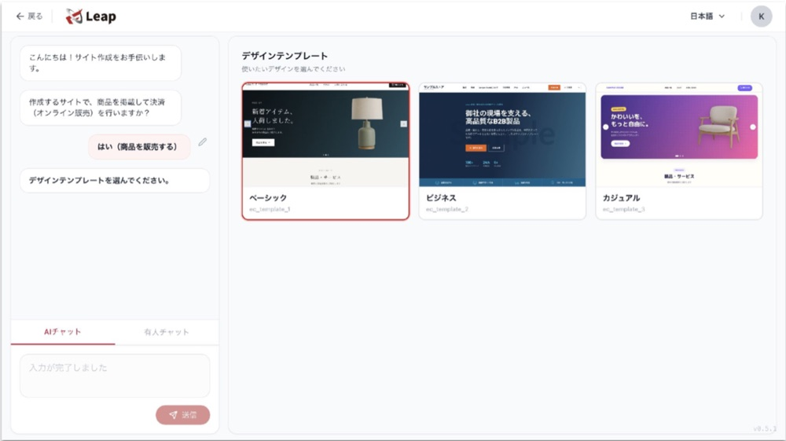

## 【一分钟速览】跨境电商怎么做

做跨境电商可以按8个步骤上线：确定目标国家和商品 → 确认法规与关税 → 选择销售渠道 → 定价 → 搭建网站和支付 → 确定配送与出口手续 → 建立客服体系 → 开始引流和试销。按这个顺序推进，可以避免上线后才发现"这个商品在当地不能卖""算上运费就亏本"之类的返工。

本文面向想要开展跨境电商的中小企业负责人，按顺序讲解上线流程以及每个步骤需要准备的事项。文中还整理了从日本邮寄商品到海外时的出口手续、运费对定价影响的测算，以及上线前的准备事项清单。

## 跨境电商的8个上线步骤

跨境电商是指通过网上销售，把商品跨越国境卖给海外消费者。跨境电商的上线流程分为以下8个步骤：

1. 确定目标国家和商品
2. 确认进出口法规和关税
3. 选择销售渠道
4. 把运费、关税、手续费算进去，确定价格和收支
5. 准备跨境电商网站、商品页面和支付方式
6. 确定配送方式和出口手续
7. 建立咨询和退货的处理体系
8. 开始引流和试销，根据反馈持续改进

第1到第4步是规划阶段，决定"卖什么、卖到哪里、卖多少钱"；第5到第8步是执行阶段，让商品"能卖出去，并在销售中不断优化"。在搭建网站之前完成规划阶段，是让跨境电商尽快上线的关键。

## 第1步：确定目标国家和商品

跨境电商的第一步，是把目标国家和首批商品锁定为一个组合。不同国家畅销的商品、常用的支付方式、主流的电商平台和社交媒体都不一样，如果不先明确"卖给哪个国家的什么人、卖什么商品"，后面的步骤就无从决定。

选择目标国家时，可以从以下几个角度比较候选国家：

- 当地是否已经有同类商品在售（在当地电商平台和搜索结果中确认）
- 同类商品在当地的售价是多少
- 从日本发货需要多少天、运费多少
- 能否用当地语言准备商品页面和客服

一般建议先从1个国家、少量商品开始。如果同时进入多个国家，法规确认、翻译、物流准备的工作量都会随国家数量成倍增加。

## 第2步：确认进出口法规和关税

确定了候选国家和商品之后，要确认三件事：商品能否从日本寄出、能否在目标国家销售、需要缴纳多少关税。尤其是食品、化妆品、保健食品、电器等商品，各国对成分、标签和安全标准的规定不同，有时无法直接销售。

需要确认的项目有以下3个：

1. **能否从日本寄出**：国际邮件中，喷雾罐、香水、指甲油、充电宝等物品寄往任何国家都不被接受。各目的国还有各自的禁寄物品，可以通过日本邮政的"国际邮件禁寄物品"页面和按国家查询功能确认。
2. **是否属于目标国家的进口限制范围**：日本贸易振兴机构（JETRO）整理了约60个主要国家和地区的基本进出口制度。
3. **关税税率是多少**：可以通过JETRO的"世界各国关税税率（WorldTariff）"按商品查询关税税率。

### 在销售国也要申请商标

商标即使在日本已经注册，在国外也不能作为权利成立，因此需要在销售国另行申请。日本特许厅指出，知识产权在各国相互独立；如果不在目标市场取得商标，可能被其他公司抢先注册，导致自己无法使用自有品牌。根据日本特许厅的外国申请补助金（2026财年），中小企业的外国申请费用可获得一半的补助，商标每件案件的补助上限为60万日元（截至2026年11月）。

## 第3步：选择跨境电商的销售渠道

跨境电商的销售渠道主要有3种：入驻海外电商平台、在现有的日本网店上接入海外销售服务、搭建自己的跨境电商独立站。此外，还可以把上架、翻译、广告等工作外包给代运营公司，这种方式可以与上述任何一种渠道搭配使用。

| 销售渠道 | 上手难度 | 引流 | 费用构成 | 适合的情况 |
|---|---|---|---|---|
| 入驻海外电商平台 | 能较快开始 | 可借助平台流量 | 店铺费、销售佣金 | 想先验证需求 |
| 在现有网店接入海外销售服务 | 保持现有网站即可开始 | 依赖现有网站的流量 | 因服务而异（如按海外销售额收取的手续费） | 想在不改动网站的情况下小规模试水 |
| 搭建自己的跨境电商独立站 | 准备需要时间 | 需要自己引流 | 工具月费、支付手续费、营销费用 | 想把品牌和客户数据掌握在自己手中 |

海外电商平台的主流因国家和地区而异，包括Amazon、Shopee、Lazada等。平台流量大，但需要支付销售佣金，而且消费者很容易比价。独立站不需要支付平台佣金，设计和客户数据都由自己掌握，但所有流量都需要自己获取。很多企业会采用分阶段的做法：先在平台上验证需求，再扩展到独立站。

## 第4步：把运费、关税、手续费算进去，确定价格和收支

跨境电商的售价，要在商品成本之上加上国际运费、关税、平台和支付手续费以及汇率波动来确定。如果直接沿用国内售价，利润可能被运费和手续费吃掉。因此上线前要先算清楚"每卖出一单能剩多少钱"以及"每月卖出多少单才能收回广告费"。

关税由目的国的制度决定。要事先确定关税由买家还是卖家承担，并在商品页面上写清楚，这样可以避免买家在收货时遇到意料之外的费用而拒收。

### 运费测算示例：运费占售价的比例

可以用日本邮政EMS（国际特快专递）的资费来测算运费对售价的影响。寄往中国、韩国、台湾的第1区资费为：500克以内1,450日元，1公斤以内2,200日元（截至2026年11月）。

| 商品价格 | 包装后重量 | EMS运费（第1区） | 运费占商品价格的比例 |
|---|---|---|---|
| 3,000日元 | 1公斤以内 | 2,200日元 | 约73% |
| 10,000日元 | 1公斤以内 | 2,200日元 | 22% |

同样是1公斤的包裹，3,000日元的商品运费超过商品价格的七成，而10,000日元的商品只占两成左右。对于单价较低的商品，可以做成组合套装、设置满额减免运费等，把运费的呈现方式也纳入定价设计。

## 第5步：准备跨境电商网站、商品页面和支付方式

确定销售渠道后，要把网站、商品页面和支付方式准备好，让目标国家的买家可以顺利下单。需要准备的内容如下：

- **商品页面翻译**：仅靠机器翻译容易留下生硬的表达，最好请熟悉当地语言的人审核
- **货币显示**：用目标国家买家熟悉的货币显示价格
- **支付方式**：以信用卡为基础，考虑支持目标国家常用的支付方式（例如中国的支付宝）
- **条款和政策**：用当地语言写明运费、配送时间、退货条件和关税由谁承担
- **商品图片**：准备能清楚展示质感和尺寸的照片

翻译时要注重本地化（根据当地文化和习惯调整表达），而不是直译。在日本打动人心的卖点，在海外不一定同样有效。

## 第6步：确定配送方式和出口手续

跨境电商常见的配送方式有3种：通过国际邮件或国际快递逐单直接发货；把库存放在日本国内发货代理服务的仓库，由对方代为发货；在目的国设立仓库存放库存。起步阶段订单较少时，一般先从没有初期费用的直接发货开始，订单量增加后再考虑发货代理服务。

### 从日本邮寄商品到海外时的出口手续

从日本通过邮政把商品寄到海外时，出口手续因邮件价值是否超过20万日元而不同。根据日本海关的说明：

1. **20万日元及以下**：无需向海关申报出口。通过日本邮政的"国际邮件My Page"服务填写海关申报单，贴在邮件上寄出即可。
2. **超过20万日元**：需要向海关申报出口。准备好发票等单据，委托报关行等办理，或自行申报。

### 保存享受消费税出口免税所需的凭证

作为出口进行的商品销售，可以免征日本消费税（出口免税）。根据日本国税厅的说明，享受出口免税需要将证明材料保存7年，邮寄出口时所需的材料因价值而异：超过20万日元的需要出口许可书；20万日元及以下的包裹或EMS，需要日本邮政出具的收寄证明材料以及发货单等的存根。

## 第7步：建立咨询和退货的处理体系

开展跨境电商，要在开始销售之前，建立能用目标国家语言回复咨询的体系。因为与国内电商相比，配送延误、关税收费、商品破损等咨询的种类会更多。

建立体系时，需要事先确定以下3点：

1. 咨询渠道（邮件、在线聊天）以及回复的大致时限
2. 汇总常见问题（运费、配送时间、关税、退货）的FAQ页面
3. 发生破损、丢失、退货时，各项费用由谁承担

## 第8步：开始引流和试销，根据反馈持续改进

跨境电商网站仅仅上线很难带来订单，因此要在上线的同时开始引流，并根据试销结果不断改进。即使入驻平台，也需要做站内广告、积累评价；如果是独立站，则要通过当地语言的SEO（搜索引擎优化）、社交媒体、广告、邮件营销等方式获取买家。

试销期间需要关注的数据包括：

- 访客来自哪些国家、进入了哪些页面
- 浏览商品页面的人中有百分之几下单
- 放弃购买的人在哪个环节离开（例如运费显示页面、支付页面）
- 咨询中最常见的问题是什么

当看清哪些国家和商品反响较好后，再进入下一步决策：增加商品、加大广告投入，或拓展到其他国家。

## 跨境电商上线前的准备事项清单

开展跨境电商之前需要准备的事项如下：

- 已确定目标国家和首批销售的商品
- 已确认商品能从日本寄出，并能在目标国家销售
- 已查询关税税率，并确定关税由谁承担
- 已考虑在目标国家申请商标
- 已确定销售渠道（平台、海外销售服务或独立站）
- 已计算包含运费和手续费的价格及每月收支
- 已安排商品页面翻译以及熟悉当地语言的人员审核
- 已确定支付方式和显示的货币
- 已确定配送方式，以及超过20万日元时的出口申报方式
- 已确定出口免税凭证的保存方法
- 已准备好咨询渠道、FAQ页面和退货条件
- 已确定引流方式以及试销时要关注的数据

## 用Leap通过对话上线跨境电商的流程

使用连获客都能交给AI的跨境电商工具Leap，第5步和第8步主要可以通过对话完成。

1. 回答对话中的问题，选择模板搭建网站
2. 为每个商品设置销售国家和基准货币
3. 采纳AI提出的本地化建议
4. 查看各国访问量，用于测试营销

## 常见问题（FAQ）

**Q. 个人或小公司也能做跨境电商吗？**

A. 可以，个人和小公司也能做跨境电商。入驻海外电商平台，或在现有网店接入海外销售服务，都不需要大额的初期投入。比较现实的做法是先从1个国家、少量商品开始，再根据反馈逐步扩大。

**Q. 做跨境电商需要多少钱？**

A. 跨境电商的费用因销售渠道差异很大，没有统一的金额。把费用拆分为"初期费用""每月固定费用""按销售额收取的手续费""运费和广告费"4类来估算，更便于比较不同渠道。从一开始就把广告费列入预算，计划会更不容易被打乱。

**Q. 一开始应该选平台还是独立站？**

A. 想尽快验证需求，适合选平台；想把品牌和客户数据掌握在自己手中，适合选独立站。平台可以借助其流量，但要支付销售佣金；独立站可以降低手续费，但需要自己引流。也可以先在平台上找出畅销品，再扩展到独立站。

**Q. 开始做跨境电商要注意什么？**

A. 最需要注意的是目标国家的法规，以及包含运费和关税的定价。不确认法规就上架，可能被叫停销售；不把运费和手续费算进价格，就会亏本。如果从日本邮寄发货，还要注意价值超过20万日元的邮件需要向海关申报出口。

## 总结与思考

跨境电商可以按8个步骤上线：确定目标国家和商品，确认法规和关税，选择销售渠道，定价，准备网站和支付，安排配送和出口手续，建立客服体系，并通过引流和试销不断改进。

回顾这8个步骤会发现，搭建网站只是其中的第5步；真正在很大程度上决定成败的，是第1到第4步"卖什么、卖到哪里、卖多少钱"的规划阶段。正如运费测算所示，同样的商品，利润能留下多少，很大程度上取决于价格和销售方式的设计。先用1个国家、少量商品认真完成规划，再一边观察试销数据一边扩展，是稳妥推进跨境电商上线的捷径。

Leap是一款连获客都能交给AI的跨境电商工具。只需通过对话，即可完成多语言、多币种跨境电商网站的搭建，以及SEO、邮件营销等海外获客工作。

## 参考资料

- [6201 向外国寄送邮件时的手续（Customs Answer）- 日本海关](https://www.customs.go.jp/tetsuzuki/c-answer/kokusaiyubin/6201_jr.htm)
- [No.6551 出口交易的免税 - 日本国税厅](https://www.nta.go.jp/taxes/shiraberu/taxanswer/shohi/6551.htm)
- [EMS资费表 - 日本邮政](https://www.post.japanpost.jp/send/oversea/charge/list-ems/all.html)
- [国际邮件禁寄物品 - 日本邮政](https://www.post.japanpost.jp/service/send/oversea/attention/restriction/)
- [各国进出口基本制度 - JETRO](https://www.jetro.go.jp/world/trade.html)
- [世界各国关税税率（WorldTariff）- JETRO](https://www.jetro.go.jp/theme/export/tariff/)
- [外国申请费用半额补助 - 日本特许厅](https://www.jpo.go.jp/support/chusho/shien_gaikokusyutugan.html)
